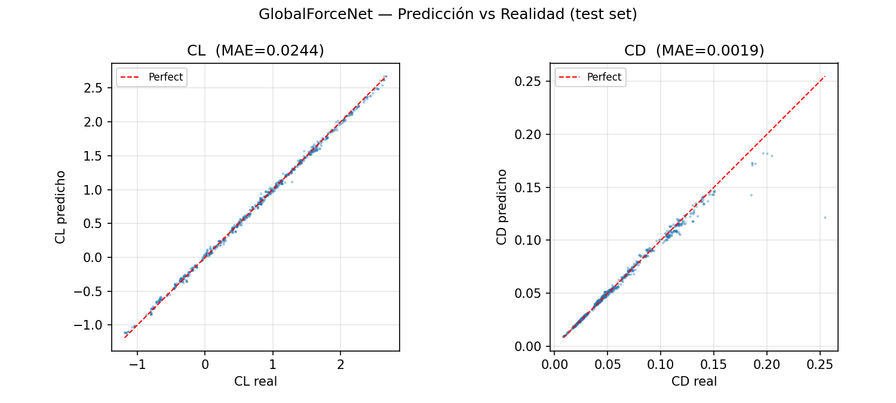
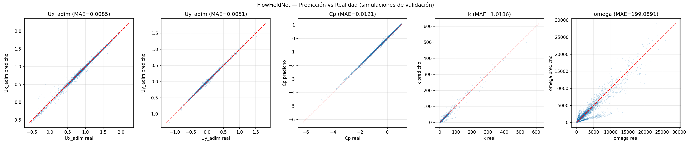

# AeroSurrogate

Neural-network surrogate model for the aerodynamics of NACA 4-digit airfoils, trained on
2D RANS CFD simulations (OpenFOAM `simpleFoam`, k-ω SST).

Two networks replace the CFD solver at inference time:

- **GlobalForceNet** predicts the global coefficients **CL** and **CD**.
- **FlowFieldNet** predicts the local flow fields **Ux, Uy, Cp, k, ω** at any point around the airfoil.

They are served through an interactive **Streamlit** app with two modes:

- **Direct mode** ("Calculadora de Campos"): set the flow speed, chord, angle of attack and
  geometry, then get CL, CD, CL/CD and interactive contour maps of the flow fields in milliseconds.
- **Inverse mode** ("Optimizador Geométrico"): a genetic algorithm searches the geometry and
  angle of attack that maximise CL/CD for a given speed and chord. Any parameter, or the
  thickness, can optionally be fixed.

> The app UI is in Spanish.

---

AeroSurrogate is also available to use directly at https://aerosurrogate.streamlit.app/

---

## Quick start (no OpenFOAM needed)

The trained models, scalers and the forces dataset are already in the repository,
so **you only need Python to run the app**. No CFD software or simulation data is required.

```bash
git clone https://github.com/diegodrak03/AeroSurrogate.git
cd AeroSurrogate

python -m venv .venv
source .venv/bin/activate          # Windows: .venv\Scripts\activate

# Optional but recommended: CPU-only PyTorch (much smaller download, no GPU needed)
pip install torch --index-url https://download.pytorch.org/whl/cpu

pip install -r requirements.txt
streamlit run app/app.py
```

The app opens at <http://localhost:8501>. Inference runs on the CPU, and a full optimisation
takes well under a second.

Tested with Python 3.13.

---

## Geometry parameterisation

The airfoil is described by three coefficients that map to the standard NACA 4-digit parameters
(see [geometry/airfoil.py](geometry/airfoil.py)):

| Coefficient | Meaning | Formula |
|---|---|---|
| C1 | upper-surface (extrados) contribution | |
| C2 | lower-surface (intrados) contribution | |
| t  | maximum thickness | t = C1 + C2 |
| m  | maximum camber | m = (C1 − C2) / 2 |
| p  | chordwise position of maximum camber | p = C3 |

All values are fractions of the chord. In the app the geometry sliders are shown in metres,
scaled by the chosen chord.

## Validity range

The models are only reliable inside the range covered by the training data. The app warns
you when you leave it.

| Parameter | Range |
|---|---|
| Reynolds number | 1·10⁶ – 2·10⁷ |
| Angle of attack α | −8° to 16° |
| C1 | 0.05 – 0.20 |
| C2 | −0.03 – 0.10 |
| C3 | 0.2 – 0.5 |
| Thickness t | 2 % – 30 % of chord |
| Mach number | < 0.3 (the data comes from an incompressible solver) |

Air properties: ν = 1.5·10⁻⁵ m²/s, ρ = 1.225 kg/m³. The Reynolds number is computed as Re = U·c/ν.

The training data is a full-factorial grid: C1 ∈ {0.05, 0.10, 0.20}, C2 ∈ {−0.03, 0, 0.04, 0.08, 0.10},
C3 ∈ {0.2, 0.4, 0.5}, U ∈ {15, 45, 80, 100} m/s, α ∈ {−8, −4, 0, 4, 8, 12, 16}° and c ∈ {1, 2, 3} m.
3,614 converged cases are kept. Predictions between grid points are interpolations by the
networks.

---

## Repository layout

```
app/app.py                     Streamlit app (direct mode + GA optimiser)
geometry/airfoil.py            NACA 4-digit profile generator
training/models.py             Network architectures (shared by training and app)
training/force_net.pth         Trained GlobalForceNet weights
training/field_net.pth         Trained FlowFieldNet weights
training/scaler_*.pkl          Input/output StandardScalers
training/dataset_forces.csv    CL/CD dataset (also used by the app for slider limits)
training/train_force_net.py    Trains GlobalForceNet
training/train_field_net.py    Trains FlowFieldNet
training/build_dataset.py      Builds the CSV datasets from the CFD results
training/plots/                Training curves and prediction-vs-truth plots
simulations/pipeline.py        Automated CFD campaign (Gmsh + OpenFOAM)
run_pipeline.py                Runs the whole pipeline end to end
```

## Results

Prediction vs. ground truth on held-out data:




FlowFieldNet is validated on **whole simulations held out from training** (split by
simulation, not by mesh point), so the reported error reflects generalisation to unseen
geometry/flow conditions.

---

## Regenerating the dataset and models (optional)

This is **not needed to use the app**. It is only needed if you want to rerun the CFD campaign
or retrain the networks. Requirements:

- [OpenFOAM](https://www.openfoam.com/) (v2406 was used) and [Gmsh](https://gmsh.info/) on the `PATH`
- About 21 GB of disk for the simulation results (`simulations/dataset/`) and about 4 GB for
  `training/dataset_fields.csv`. Neither is included in this repository.
- Enough RAM to load around 37M mesh points to train FlowFieldNet

```bash
python run_pipeline.py              # 1 CFD → 2 build dataset → 3 train ForceNet → 4 train FieldNet
python run_pipeline.py --from 2     # skip the CFD step (requires simulations/dataset/)
python run_pipeline.py --only 3     # retrain GlobalForceNet only (dataset_forces.csv is in the repo)
```

Retraining GlobalForceNet works directly from the repository, because `dataset_forces.csv` is
included. FlowFieldNet needs `dataset_fields.csv`, which has to be regenerated from the
simulations.

## Author

Diego Antúnez. Bachelor's thesis (TFG).
